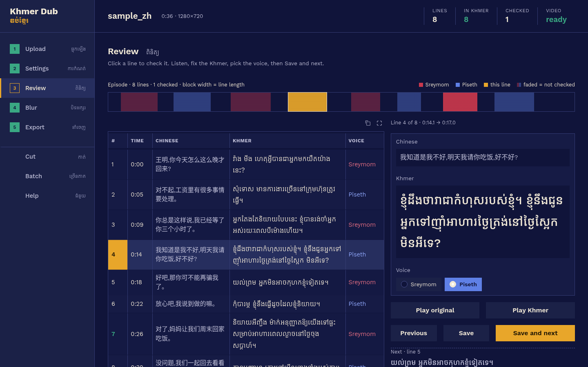

# Khmer Dub · ឌប់ខ្មែរ

Turn a Chinese video into a **Khmer video**, step by step, in your browser:

1. **Removes the Chinese voice**, keeps the music and sound effects
2. **Writes the Chinese transcript** from the speech
3. **Translates it to Khmer**: Google (free), Gemini (free key), OpenRouter / Groq (free keys), DeepSeek, Claude, ChatGPT, Ollama or an offline model
4. **Lets you check every line**: listen to the original and the Khmer, fix the text, choose the voice
5. **Dubs it in Khmer** with **Sreymom** (female) and **Piseth** (male), picked automatically from each speaker's voice
6. **Adds Khmer subtitles**: in the picture or as a separate track, bottom or top, white or yellow
7. **Blurs Chinese text** on screen: subtitles, logos and watermarks, and moving or floating text
8. **Cuts videos into parts** (10 or 15 minutes, or your own length) for TikTok and Facebook, or to dub a long
   episode piece by piece



*The Review step on a short test clip: each block in the band is one line (red Sreymom, blue Piseth), the line being
edited is in yellow.*

Works on **Windows, macOS and Linux**, with or without a graphics card. Your videos stay on your computer.
Internet is needed for the Khmer voices and for the online translators.

---

## Install and start (no programming needed)

1. **Download** this project: green **Code** button → **Download ZIP**, then unzip it
   (or `git clone https://github.com/Sokthearith/khmer-dub.git`).
2. **Start it the first time:**
   - **Windows**: double-click **`start-windows.bat`**
   - **Mac**: double-click **`start-mac.command`** (the first time: right-click → Open → Open)
   - **Linux**: run **`./start-mac-linux.sh`** in a terminal
3. Khmer Dub opens in **its own app window**, with its own icon. A small black window stays open
   behind it; it does the work, so leave it open. Closing the Khmer Dub window stops the app.

The first start also adds a **Khmer Dub** shortcut, so after that you open it like any other app:

- **Windows**: on the desktop and in the Start menu
- **Mac**: in *Applications* (your home folder's Applications) — drag it to the Dock if you like
- **Linux**: in the app menu and on the desktop

Keep the unzipped folder where it is: the shortcut points to it. If you move the folder, start it once
from the folder again and the shortcut is updated (or run `uv run --extra cpu khmerdub shortcut`).

The **first start takes 5–15 minutes**: it installs everything it needs (Python, AI models, 2–4 GB).
Later starts take a few seconds. With an NVIDIA graphics card, the launchers use it automatically.

Nothing else to install: ffmpeg comes with the app, and so does a Khmer font for the subtitles.

### Updating

When a new version is out, a bar at the top of the app says **Khmer Dub X.Y.Z is available**. Click
**Update now**, then close Khmer Dub and open it again: the update is installed as it starts. Your projects,
settings and the downloaded AI models are kept. *Help → Check for updates* checks right away.

## Using the app

The steps are listed down the left side; the top bar always shows the open project and how far it is
(lines, lines in Khmer, lines checked, video ready).

| Step | What you do |
|---|---|
| **1 · Upload** | Drop in the Chinese video (or continue a saved project). You see its length and how long processing will take. |
| **2 · Settings** | Pick a **quick choice** (Free & easy, Free AI, Best quality, Fastest) or set things yourself. Press **Start**. |
| **3 · Review** | The coloured band shows the whole episode, one block per line (red Sreymom, blue Piseth, faded = not checked yet). Click a line to fix the Khmer, play the original and the Khmer voice, switch Sreymom/Piseth, then *Save and next*. **Check timing** makes the voices and marks every line: *fits*, *×1.3* (sped up), *0.6 s long* or *late* (red, also marked under the band). Tick *Only lines to fix*, then per line: *Earlier / Later 0.1 s*, a fixed *Speed*, **Shorten** (an AI translator rewrites the line shorter) and **Play in video** to see it with the picture. *All lines → Find and Replace* fixes a name everywhere at once. |
| **4 · Blur** | See what the app will blur (green boxes). Click two corners on the picture to add your own box. Make a 20-second preview. |
| **5 · Export** | Press **Make the Khmer video**. Download the video, the Khmer subtitles (.srt), the Khmer soundtrack and the Chinese transcript. |
| **Cut** | Split the Khmer video into 10- or 15-minute parts (or any length), or keep only a range like 1:30 to 45:00. Cutting the original Chinese video can open each part as its own project. Takes seconds. |

In a hurry? Press **Do everything automatically** after uploading.
**Timing.** Each Khmer line starts when the character starts talking and is stretched or sped up (0.85×–1.5×) to end
when they stop; the app first finds those moments from the character's own voice. Lines that still don't fit are
marked in Review. Mouth shapes can't match exactly in another language, but start and end can. Prefer the old
behaviour (only speed up when a line would run into the next)? *Settings → More options → Voice timing*.

Bookmark a project: `http://localhost:7860/?project=NAME&step=review&line=120` opens it at that step and line.
Many episodes? Use the **Batch** tab: add them all and let it run (overnight, for example).

Everything is saved in the `projects` folder. If you stop halfway or close the app, pick the project again
and continue; finished steps are not repeated. After you edit a line, only that line's voice is made again.

### Translators

| Translator | Cost | Quality | Get a key |
|---|---|---|---|
| Google Translate | free, no key | OK, literal | — |
| Gemini | **free** key | good | [aistudio.google.com/apikey](https://aistudio.google.com/apikey) |
| OpenRouter | **free** key, free models | good (depends on model) | [openrouter.ai](https://openrouter.ai) |
| Groq | **free** key | good, very fast | [console.groq.com](https://console.groq.com) |
| DeepSeek | very cheap | good, strong at Chinese | [platform.deepseek.com](https://platform.deepseek.com) |
| Claude | paid, a few cents per episode | **best**, natural spoken Khmer | [console.anthropic.com](https://console.anthropic.com) |
| ChatGPT | paid | good | [platform.openai.com](https://platform.openai.com) |
| Ollama | free, runs on your computer | depends on your PC | [ollama.com](https://ollama.com) |
| NLLB offline | free, no internet | basic | — (see below) |

The AI translators read the story in batches, keep names consistent and keep lines short enough to speak in
time. Keys are only kept while the app is open; they are never written to disk. You can also set them as
environment variables (`GEMINI_API_KEY`, `ANTHROPIC_API_KEY`, `OPENAI_API_KEY`, `OPENROUTER_API_KEY`,
`GROQ_API_KEY`, `DEEPSEEK_API_KEY`). Model names change over time: type a newer one in **Model** if needed.

NLLB offline downloads its model (about 2.5 GB) the first time you use it; after that it works without
internet. If you start the app yourself instead of with the start script, add `--extra offline`
(`uv run --extra cpu --extra offline khmerdub app`).

### How the blur works

The app scans the video a few times per second, reads the text and blurs only text with Chinese characters
(English and Khmer stay sharp):

- **Still text** (logos, watermarks, the subtitle bar) gets one steady blur, even if it fades in and out.
- **Subtitle lines** are blurred while they are on screen.
- **Moving or floating text** is tracked, and the blur follows it.

Anything it misses: add a box in tab 4, or set **Scan** to *Careful*. Your Khmer subtitles sit on top of
the blurred Chinese subtitle bar.

## How long does it take?

Measured on a 12-core laptop **without a graphics card**, for a 10-minute video:

| Step | Time |
|---|---|
| Remove the Chinese voice | 8 min |
| Chinese transcript | 3.5 min |
| Translation (Google) + Khmer voices + mixing | 1.5 min |
| Scan for Chinese text | 5 min |
| Make the final video | 2 min |
| **Total** | **20 min** |

So a **1-hour episode takes about 2 hours without a graphics card** (the app shows an estimate for your
computer). With an NVIDIA GPU, removing the voice and the transcript are many times faster. To save time,
use the *Fastest* quick choice, turn the blur scan to *Fast*, or use the Batch tab overnight.
It needs about 3–4 GB of free memory (RAM) and roughly 3× the video's size in free disk space.

## For developers

**Command line**

```bash
uv run --extra cpu khmerdub run episode01.mp4                     # everything, default settings
uv run --extra cpu khmerdub run episode01.mp4 --stage prepare     # transcript + translation only
#   ...edit episode01_khmerdub/segments.json...
uv run --extra cpu khmerdub run episode01.mp4 --stage produce     # voices + final video
uv run --extra cpu khmerdub run episode01.mp4 --translator gemini --api-key KEY
uv run --extra cpu khmerdub run episode01.mp4 --blur-region 0,0.82,1,0.15   # extra blur box x,y,w,h (0-1)
uv run --extra cpu khmerdub run episode01.mp4 --preview 300       # 20 s preview from 5:00
uv run --extra cpu khmerdub run --help                            # all options
uv run --extra cpu khmerdub cut episode01_khmer.mp4 --every 15    # split into 15-minute parts
uv run --extra cpu khmerdub cut episode01.mp4 --from 1:30 --to 45:00
```

Use `--extra gpu` instead of `--extra cpu` on a computer with an NVIDIA GPU.

**API.** While the app runs, other programs can use it:

```python
from gradio_client import Client, handle_file

client = Client("http://localhost:7860/")
video, srt = client.predict(handle_file("episode01.mp4"), "google", "", "auto", "chinese", "burn",
                            api_name="/dub_video")
```

Arguments: video, translator (`google` `gemini` `claude` `openai` `custom` `nllb`), API key, voice
(`auto` `sreymom` `piseth`), blur (`chinese` `all` `off`), subtitles (`burn` `soft` `none`), and optionally
model, provider (`openrouter` `groq` `deepseek` `ollama` `other`) and base URL. A wrong value is refused
with the list of allowed ones.
`khmerdub app` opens the app window (what the start scripts run); `khmerdub ui` serves it to a browser instead, and `khmerdub ui --share` adds a temporary public link.

**How it works**

```
video ─► audio ─► Demucs ─┬─► vocals ─► Whisper (Chinese) ─► translator (Khmer) ─► review in the app
                          │                └─► pitch ─► Sreymom / Piseth per line
                          └─► music + effects ──────────────────────────────┐
review ─► Edge TTS Khmer voices ─► fit to timing (speed up ≤1.5×) ─► mix ───┴─► final video
video ─► RapidOCR text scan ─► tracks (still / moving) ─► blur ─► + Khmer subtitles (libass) ─┘
```

`src/khmerdub/` has one module per step (`separate`, `transcribe`, `translate`, `voices`, `tts`, `mix`,
`subtitles`, `blur`, `render`), `pipeline.py` (order and caching), `cli.py` and `ui.py` (the web app).

**Publishing a new version** (for the maintainer): commit your changes, then

```bash
uv run python scripts/release.py 0.3.0 "One-line summary of what's new"
```

This sets the version, tags it, pushes, and creates the GitHub Release that everyone's app offers as an
update. A copy that is a git folder never updates itself; use `git pull` there.

## Troubleshooting

- **It opens in the browser instead of its own window:** the app window needs Microsoft Edge WebView2 on
  Windows (already part of Windows 10 and 11), and Chrome, Chromium or Edge on Linux. Without them it falls
  back to your browser, which works the same.

- **The black window closes right away (Windows):** right-click `start-windows.bat` → *Run as administrator*
  once, or install [uv](https://docs.astral.sh/uv/getting-started/installation/) yourself, then try again.
- **"API key is missing or wrong":** paste the key for the translator you chose, or switch to Google.
- **Khmer voice step fails:** the Sreymom/Piseth voices come from Microsoft's online Edge read-aloud service
  and need internet. Press the button again; it continues where it stopped.
- **Wrong voice (man/woman) on some lines:** fix them in tab 3, or choose *Only Sreymom* / *Only Piseth*.
- **Some Chinese text is not blurred:** set Scan to *Careful*, or add a box in tab 4.
- **Subtitles come out as a separate track instead of in the picture:** your system ffmpeg has no subtitle
  support. Install a full ffmpeg from <https://ffmpeg.org>.
- **Very slow:** that's normal without a GPU (see the table above). Use *Fastest*, or Batch overnight.

## Credits

[faster-whisper](https://github.com/SYSTRAN/faster-whisper) (MIT) ·
[Demucs](https://github.com/facebookresearch/demucs) (MIT) ·
[edge-tts](https://github.com/rany2/edge-tts) (LGPL-3.0) ·
[RapidOCR](https://github.com/RapidAI/RapidOCR) / PaddleOCR models (Apache-2.0) ·
[Gradio](https://gradio.app) (Apache-2.0) ·
[Noto Sans Khmer](https://github.com/notofonts/khmer) (OFL) ·
ffmpeg.

Only dub and publish videos you have the rights to use.
